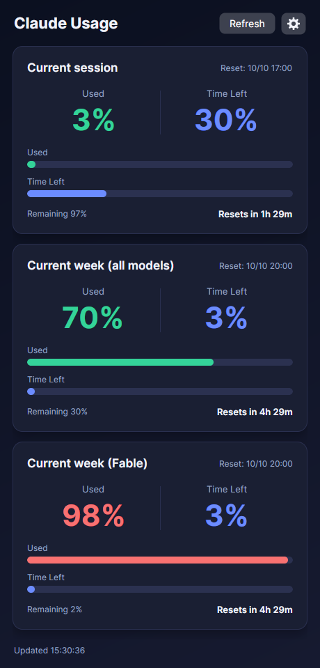
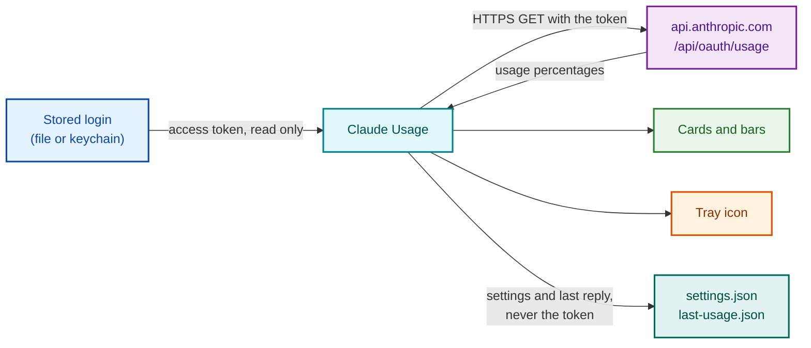

<div align="center">


# Claude Usage

**See how much of your Claude plan is left, at a glance.**

A small desktop app for Windows, macOS and Linux that shows your session and
weekly usage limits, how much time is left in each window, and when they reset.

[](https://github.com/RetroCoreLabs/claude-ui/actions/workflows/ci.yml)
[](https://github.com/RetroCoreLabs/claude-ui/releases/latest)
[](https://github.com/RetroCoreLabs/claude-ui/releases)
[](LICENSE)




</div>

## Contents

- [Features](#features)
- [Install](#install)
- [Use](#use)
- [Settings](#settings)
- [Where the app finds your login](#where-the-app-finds-your-login)
- [Privacy and security](#privacy-and-security)
- [Rate limiting](#rate-limiting)
- [Build from source](#build-from-source)
- [Releases](#releases)
- [Project layout](#project-layout)
- [Disclaimer](#disclaimer)
- [License](#license)

## Features

| | |
| --- | --- |
| :bar_chart: **One card per limit** | Current session, current week (all models), and one card for each model-specific weekly limit. |
| :hourglass_flowing_sand: **Time left** | Days, hours and minutes until the reset, a bar for the share of the window that is left, and the local reset time. |
| :traffic_light: **Colour by severity** | Green, amber or red, taken from the severity the server reports for each limit. |
| :arrows_counterclockwise: **Remaining or used** | Choose which of the two the big number and the bar show. |
| :pushpin: **Tray icon** | A coloured number in the system tray, redrawn on every update, with all limits in the tooltip. |
| :gear: **Settings in the window** | Cogwheel button; changes apply at once and are saved. |
| :shield: **Polite to the server** | Backs off after a rate-limit reply and shows the last known values meanwhile. |
| :package: **Nothing to install** | One self-contained file per system. No runtime needed. |

## Install

1. Sign in with the Claude CLI on the machine, if you have not already. The app
   reuses that login; it has no sign-in screen of its own.
2. Download the file for your system from the
   [latest release](https://github.com/RetroCoreLabs/claude-ui/releases/latest).
3. Unpack it and start `ClaudeUsage` (`ClaudeUsage.exe` on Windows).

| System | File |
| --- | --- |
| Windows x64 / arm64 | `ClaudeUsage-<version>-win-x64.zip` / `-win-arm64.zip` |
| macOS Apple silicon / Intel | `ClaudeUsage-<version>-osx-arm64.tar.gz` / `-osx-x64.tar.gz` |
| Linux x64 / arm64 | `ClaudeUsage-<version>-linux-x64.tar.gz` / `-linux-arm64.tar.gz` |

Each release also has a `SHA256SUMS.txt` to check the downloads against.

**Linux:** the download also holds `install.sh`. Running it puts the program,
its icon and a menu entry under `~/.local/share`, so the app appears in the
application menu with its icon. Nothing goes outside the home folder and no
root is needed. `./install.sh --uninstall` removes it again.

```
tar -xzf ClaudeUsage-<version>-linux-x64.tar.gz
cd ClaudeUsage-linux-x64
./install.sh
```

Under WSL the window frame is drawn by WSLg, which shows its own default
picture in the frame's top-left corner whatever icon the app has.

**macOS:** the program is not signed or notarised. If macOS refuses to start
it, remove the quarantine mark once:

```
xattr -d com.apple.quarantine ClaudeUsage
```

> [!NOTE]
> The app is developed and tested on Linux. The Windows and macOS programs are
> built by the release workflow and have not yet been tested on real machines.
> Reports are welcome in the
> [issue tracker](https://github.com/RetroCoreLabs/claude-ui/issues).

## Use

Start the app. The window opens tall enough to show every card.

Each card shows:

- the **remaining** or the **used** percent of the limit, as a number and a bar
- **Time Left**: the time until the reset, as days, hours and minutes
  (`4d 3h 12m`), hours and minutes (`4h 29m`) or minutes (`29m`), and a bar
  showing how much of the limit's time window is still ahead
- **Resets at**: the local reset time, with the date when it is not today

The **Refresh** button fetches at once. The **cogwheel** opens the settings.
The line at the bottom shows the time of the last update, or the reason a fetch
failed.

The tray icon shows one limit as a number in that limit's colour. Clicking it
brings the window to the front; its menu has **Open**, **Refresh** and **Exit**.
Closing the window exits the app.

On Windows, minimising the window hides it from the taskbar; the app keeps
running as the tray icon, and a click on the icon brings the window back. On
macOS and Linux the window minimises the normal way.

### How the "Time Left" bar is calculated

The bar is the time until the reset as a share of the whole window.

| Limit | Window start | Window end |
| --- | --- | --- |
| Weekly | `seven_day_breakdown.window_started_at` in the reply (7 days before the reset if that field is missing) | `resets_at` |
| Session | 5 hours before the reset. The reply has no session start time; 5 hours is taken from the reply's field name `five_hour`. | `resets_at` |

## Settings

Open them with the cogwheel. A change takes effect at once and is saved.

| Setting | Choices | Default |
| --- | --- | --- |
| **Show** | Remaining, Used | Remaining |
| **Tray icon shows** | Current session, Current week (all models), Current week (model limit), Lowest remaining | Current week (all models) |
| **Refresh** | Manual only, every 10 s, 30 s, 1 min, 5 min | Every 5 minutes |

### Where settings are stored

The app keeps two small files in a `ClaudeUsage` folder inside the per-user
application data folder:

| System | Folder |
| --- | --- |
| Windows | `%APPDATA%\ClaudeUsage` |
| macOS | `~/Library/Application Support/ClaudeUsage` |
| Linux | `$XDG_CONFIG_HOME/ClaudeUsage`, normally `~/.config/ClaudeUsage` |

| File | Contents |
| --- | --- |
| `settings.json` | The three settings above. Created with the defaults on first start. |
| `last-usage.json` | The last good reply from the server, when it was fetched, and the end time of a rate-limit block if one is active. |

Neither file ever contains your token.

`settings.json` can also be edited by hand while the app is closed:

```json
{
  "refreshSeconds": 300,
  "trayLimit": "weekly_all",
  "displayMode": "remaining"
}
```

| Key | Meaning |
| --- | --- |
| `refreshSeconds` | Seconds between fetches. `0` fetches only when **Refresh** is pressed. Values from 1 to 4 are raised to 5. |
| `trayLimit` | `session`, `weekly_all`, `weekly_scoped`, or `lowest` for whichever limit has the least remaining. |
| `displayMode` | `remaining` or `used`. |

## Where the app finds your login

The app does not sign in and stores no login of its own. It reads the OAuth
access token that the Claude CLI saved when you signed in, fresh for every
request. It looks in this order and uses the first place that has a token:

| # | Place | Systems |
| --- | --- | --- |
| 1 | The file named by the environment variable `CLAUDE_USAGE_CREDENTIALS` | all |
| 2 | The login keychain item written by the Claude CLI | macOS |
| 3 | `.credentials.json` in the Claude config folder | all |

The Claude config folder is the folder named by the environment variable
`CLAUDE_CONFIG_DIR` if it is set, otherwise `.claude` in your home folder:

| System | Default credentials file |
| --- | --- |
| Linux | `~/.claude/.credentials.json` |
| Windows | `%USERPROFILE%\.claude\.credentials.json` |
| macOS | Keychain first; `~/.claude/.credentials.json` if the keychain has no item |

In every place the app expects the same JSON and reads one field from it,
`claudeAiOauth.accessToken`.

**macOS keychain details.** The app runs
`security find-generic-password -a <your user name> -w -s <service>`,
the same lookup the Claude CLI does. macOS may ask you to allow the access the
first time. When `CLAUDE_CONFIG_DIR` is set, the CLI adds a dash and the first
8 hex digits of the SHA-256 of that folder path to the service name, and the
app does the same.

**When the token expires.** The app does not renew tokens. The Claude CLI does
that as you use it and rewrites the stored login; the app picks up the new token
on its next fetch. If the server rejects the token, the status line shows
`HTTP 401` until then.

## Privacy and security



- The token is sent to one address only: `https://api.anthropic.com/api/oauth/usage`.
- The token is held in memory for the length of one request. It is never
  written to disk, logged, or shown.
- The app makes no other network requests: no telemetry, no update check.
- The login files and the keychain item are only read, never changed.

## Rate limiting

The usage endpoint refuses requests that come too often, with HTTP 429. The
limit is not published. A short interval such as 30 seconds can trigger it, and
the block then applies to every program using the same login, including the
Claude CLI's own usage display.

After a 429 the app sends no request for 5 minutes (or for the time in the
server's `retry-after` header if it gives one, at most 1 hour) and the status
line shows the time of the next try. **Refresh** is ignored during that time.
A start during a block shows the last known values, with the time they were
fetched, and sends no request.

## Build from source

Requires the [.NET 10 SDK](https://dotnet.microsoft.com/download).

```
git clone https://github.com/RetroCoreLabs/claude-ui.git
cd claude-ui
dotnet run --project src/ClaudeUsage
```

The build treats warnings as errors.

A self-contained single-file program for one system (`linux-x64`,
`linux-arm64`, `win-x64`, `win-arm64`, `osx-x64`, `osx-arm64`):

```
dotnet publish src/ClaudeUsage/ClaudeUsage.csproj -c Release -r linux-x64 --self-contained true -p:PublishSingleFile=true -p:IncludeNativeLibrariesForSelfExtract=true -o publish/linux-x64
```

## Releases

Pushing a tag that starts with `v` runs the
[release workflow](.github/workflows/release.yml). It builds the six programs,
packs them, writes `SHA256SUMS.txt` and creates the GitHub release with
generated notes.

```
git tag v0.1.0
git push origin v0.1.0
```

Every push and pull request is built on Windows, macOS and Linux by the
[CI workflow](.github/workflows/ci.yml).

## Project layout

| Path | Contents |
| --- | --- |
| `src/ClaudeUsage/Services/CredentialStore.cs` | Finds the access token (file or macOS keychain) |
| `src/ClaudeUsage/Services/UsageClient.cs` | Calls the usage endpoint |
| `src/ClaudeUsage/Services/AppSettings.cs` | Reads and writes `settings.json` |
| `src/ClaudeUsage/Services/UsageCache.cs` | Reads and writes `last-usage.json` |
| `src/ClaudeUsage/Services/TrayIconRenderer.cs` | Draws the tray icon picture |
| `src/ClaudeUsage/Models/UsageResponse.cs` | The JSON fields the app uses |
| `src/ClaudeUsage/ViewModels/` | Card values, countdown, settings, refresh timer |
| `src/ClaudeUsage/Views/MainWindow.axaml` | The window and card design |
| `src/ClaudeUsage/App.axaml.cs` | Tray icon, its menu, start-up |
| `assets/icon.svg` | Source of the app icon |
| `packaging/linux/` | Menu entry, icons and `install.sh` for Linux |
| `.github/workflows/` | CI and release builds |

Built with [Avalonia](https://avaloniaui.net/) 12 and C#.

## Disclaimer

This is an independent, unofficial project. It is not affiliated with, endorsed
by or supported by Anthropic. "Claude" is a trademark of Anthropic, PBC. The
usage endpoint is not a documented public API and can change or stop working at
any time.

## License

[MIT](LICENSE) &copy; 2026 Ronny Hansen
